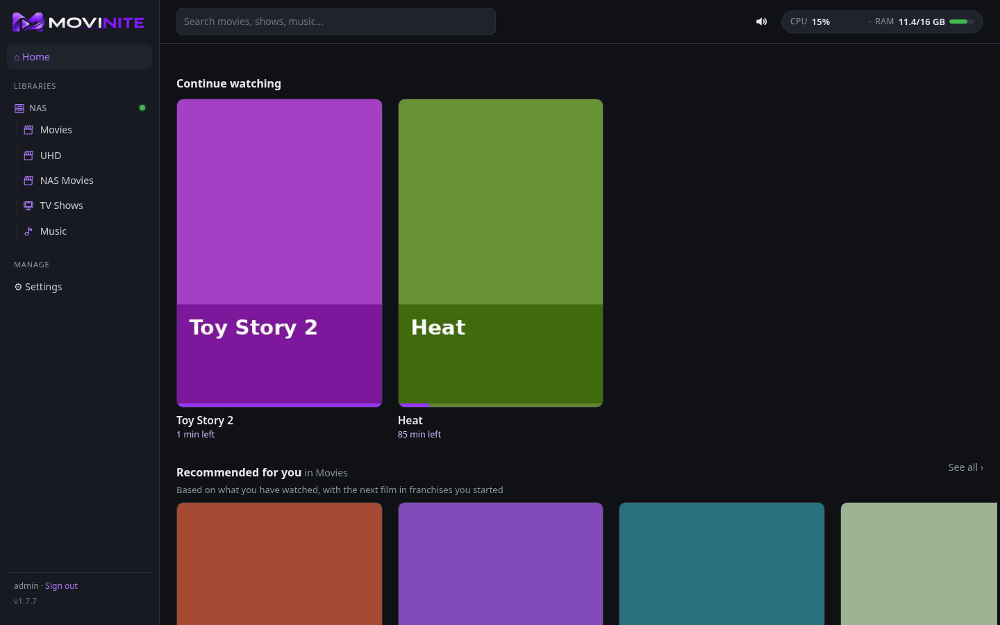
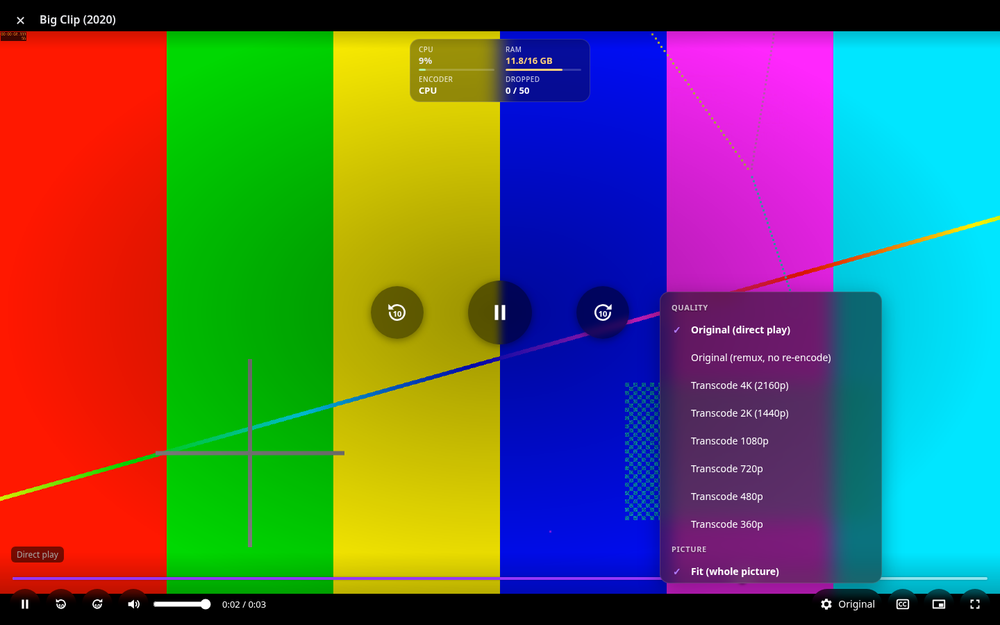
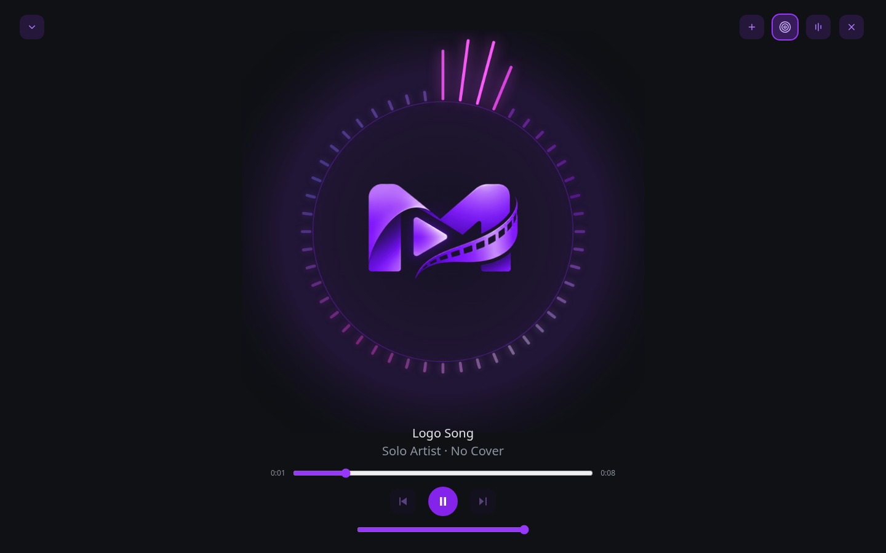
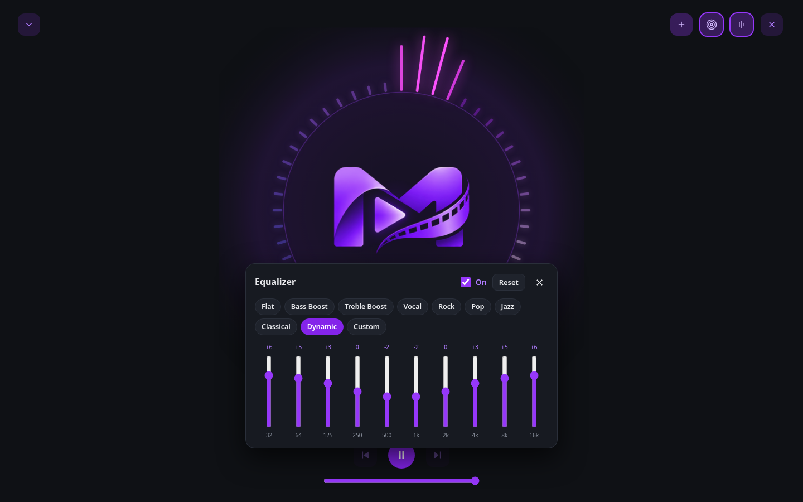
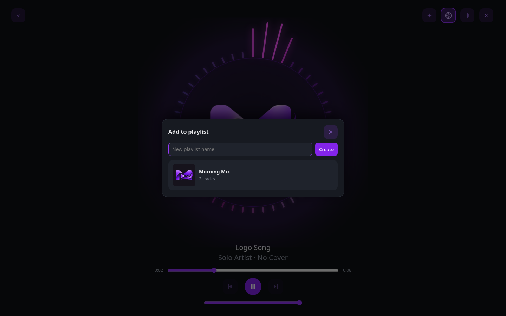
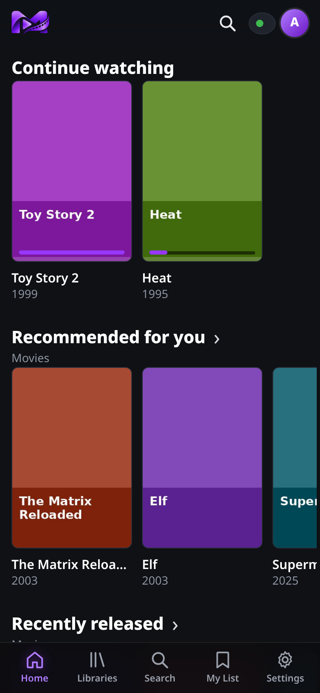
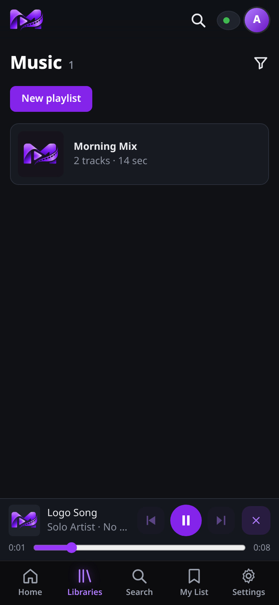

# Movinite

**A self-hosted media server for your own movies, TV shows and music.** You run it on an Ubuntu server and watch in
any browser or in the Android app. It's free and open source under the [AGPL-3.0](LICENSE).

Add a folder or a network share (SMB/NFS) as a library. Movinite scans it, fetches posters and descriptions from TMDB
(optional, with a free API key) and plays everything in the browser. It plays a file directly when the browser can,
remuxes it when only the container or audio doesn't fit, and otherwise transcodes it live with ffmpeg (HLS).
On servers with a supported video card, transcoding can run on the GPU.

| Home | Movie details |
|---|---|
|  |  |
| **Player with 2K / 4K quality** | **Add a library from an existing share** |
|  |  |
| **Now playing** | **Music equalizer** |
|  |  |
| **Add to a playlist** | **Phone libraries** |
|  |  |

<p>






</p>

*The screenshots use generated test media and placeholder posters.*

## Features

- **Libraries** for movies, TV shows, music and other videos, from a local folder, an SMB/Windows share or an NFS export.
  Shares are mounted **read-only**. A folder browser lets you pick the folder, and once you've signed in to a share you can reuse it for more libraries.
- **Scanning** with progress, resume and scheduled rescans. Names are parsed from files and folders (title, year,
  edition, `S01E02`).
- **TMDB metadata (optional):** posters, backdrops, overviews, cast, collections, similar movies and episode titles.
- **Playback in the browser:** direct play, remux (including HEVC to fMP4) or HLS transcode with quality choices (360p to 1080p, plus 2K/4K with a GPU). Auto quality prefers direct play or remux over a transcode. Subtitles (`.srt`, embedded) are see-through and stay on after a seek or quality change; pinch to fit or fill the picture on a phone. The music player has a beat-reactive visualizer, playlists, and a 10-band equalizer with presets (including Dynamic).
- **Hardware transcoding:** Intel VAAPI/QSV (plus AMD VAAPI and NVIDIA NVENC, both untested). Video cards are detected on install. Concurrent 4K streams use extra GPU surfaces and the card's low-power encoder; a stream that cannot stay on the GPU falls back once and stays there, with the reason logged. The same account can play on more than one device at a time.
- **Home rows** (Continue watching, Recently added, Recommended), My List, search, genres, decades, tags and collections.
- **Phone layout** with a bottom tab bar and filter sheets, plus an installable web app (PWA) and a native **Android app**.
- **Multiple users** with admin and viewer roles, and a server status panel (CPU, RAM, streams).

## Requirements

- **Ubuntu Server 24.04 LTS** (22.04 also works), x86-64, with `sudo`. A VM is fine.
- About 1 GB RAM plus 1 CPU core per CPU transcode (or a supported GPU), and disk space for thumbnails and the transcode cache.
- The installer pulls in Python 3, ffmpeg, cifs-utils, nfs-common and smbclient from Ubuntu's repositories.

## Quick install

Download `media-server-verX.Y.Z.tar.gz` (and its `.sha256`) from the [Releases](../../releases) page onto the server, then run:

```bash
sha256sum -c media-server-verX.Y.Z.tar.gz.sha256
tar -xzf media-server-verX.Y.Z.tar.gz media-server/install.sh --strip-components=1
sudo bash install.sh                 # or: sudo bash install.sh --port 8096
```

The installer unpacks into `/opt/media-server`, creates a locked-down service user and the systemd service `media-server`,
then prints the address (`http://<server-ip>:8099`) and a **random admin password**. That password is also saved, readable by root only,
in `/opt/media-server/ADMIN_PASSWORD`. Sign in as `admin` and choose your own password, then delete the file.

*(Internally the app is still called `media-server`: the service, folder, tarball and API names are unchanged.)*

## Update

```bash
sudo bash /opt/media-server/update.sh /path/to/media-server-verX.Y.Z.tar.gz
```

`update.sh` checks the `.sha256` file if it's next to the tarball, then backs up the code, `.env` and the database to
`/opt/media-server/backups/`. It then installs the new code, upgrades the database, restarts the service and confirms the new version is running.
If any step fails, it rolls back automatically. To undo an update yourself:

```bash
sudo bash /opt/media-server/update.sh --rollback /opt/media-server/backups/media-server-pre-X.Y.Z-YYYYMMDD-HHMMSS.tgz
```

## GPU transcoding

- On install and the first start, Movinite looks for video cards and turns on the first method that passes a short test encode.
  You can change it any time in **Settings → Transcoding**, which has *Auto*, *VAAPI*, *Intel QSV*, *NVIDIA* and *Off (CPU)*
  options and a *Test* button for each.
- **Intel (Arc, iGPU):** the installer adds `intel-media-va-driver-non-free`, `vainfo` and the oneVPL runtime
  (`libvpl2`, `libmfx-gen1.2`) when they're available, and gives the service access to `/dev/dri/renderD*`. VAAPI works out of the box.
  If the QSV test fails, run `sudo apt install libmfx-gen1.2`.
- **AMD:** VAAPI through `mesa-va-drivers` (detected, but not tested on real hardware).
- **NVIDIA:** install the proprietary driver first. NVENC support is included but hasn't been tested on real hardware yet.
- **2K/4K** quality is offered only when the GPU is in use, and only for sources at least that size. Movinite never upscales.
  HEVC is used when the device can play it, otherwise H.264.
- **HDR** sources are converted without tone-mapping, so their colours can look flat.
- In a short preliminary test, an Intel Arc A310 handled about 6 × 4K, 10 × 2K or 12 × 1080p transcodes at once.
  Results depend on the source; see [server/README.md](server/README.md#2k-and-4k-153).

## Android app

The app is in [`android/`](android/). On first launch it asks for your server's address (for example
`https://movies.example.com` or `http://192.0.2.10:8099` on your home network) and then shows a native sign-in screen.
To change the server later, tap the gear on the sign-in screen. Picture-in-picture and rotate-to-full-screen are built in.

To install it, download `movinite-android-vX.Y.apk` from [Releases](../../releases) onto your phone, then open it from the
**Files** app. Allow "Install unknown apps" when Android asks. To build it yourself, see [android/README.md](android/README.md).

## Access from outside your network

Put Movinite behind a reverse proxy with HTTPS, such as Caddy or nginx. The examples are in
[server/README.md](server/README.md#https--access-from-outside-reverse-proxy).

## Documentation

- [server/README.md](server/README.md): full server guide (libraries, naming, TMDB, playback, shares, proxy, file locations)
- [CHANGELOG.md](CHANGELOG.md) and [server/CHANGELOG.md](server/CHANGELOG.md)
- [docs/android-signing.md](docs/android-signing.md): making a release key for the Android app
- [docs/releasing.md](docs/releasing.md): building and publishing a release (GitHub Actions)
- [CONTRIBUTING.md](CONTRIBUTING.md), [SECURITY.md](SECURITY.md), [THIRD_PARTY_NOTICES.md](THIRD_PARTY_NOTICES.md)

## License

Movinite is free software under the **GNU Affero General Public License v3.0** ([LICENSE](LICENSE)). You may use,
study, change and share it. If you share a changed version, or run one for other people over a network, you must make
its source code available under the same license.

This product uses the TMDB API but is not endorsed or certified by TMDB.
